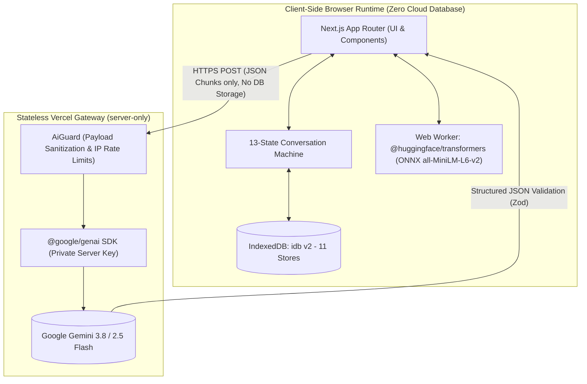
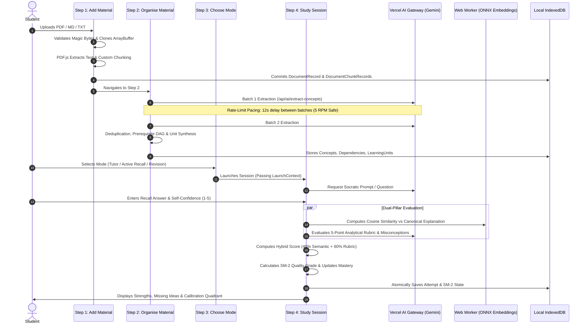
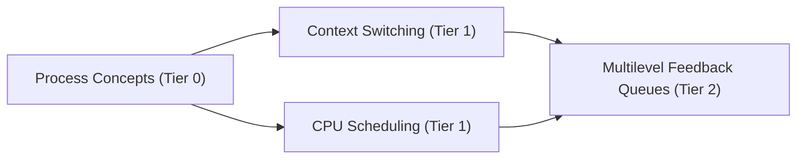

# EduMentor (Memoir.ai) — Comprehensive Project Report & Viva Voce Guide

**A Privacy-First, Source-Grounded Cognitive Learning Companion with Browser-Local Persistence and Hybrid Evaluation**

---

## Table of Contents
1. [Executive Summary & Abstract](#1-executive-summary--abstract)
2. [Problem Statement & Motivation](#2-problem-statement--motivation)
3. [Pedagogical Foundations](#3-pedagogical-foundations)
4. [System Architecture & Data Flow](#4-system-architecture--data-flow)
5. [End-to-End Workflow (Step 1 to Step 4)](#5-end-to-end-workflow-step-1-to-step-4)
6. [Technology Stack & Architectural Decisions](#6-technology-stack--architectural-decisions)
7. [Mathematical Models & Core Algorithms](#7-mathematical-models--core-algorithms)
   - [7.1 SuperMemo SM-2 Spaced Repetition](#71-supermemo-sm-2-spaced-repetition)
   - [7.2 Hybrid Dual-Pillar Evaluation Engine](#72-hybrid-dual-pillar-evaluation-engine)
   - [7.3 Topological Prerequisite Graph (DAG) & Cycle Elimination](#73-topological-prerequisite-graph-dag--cycle-elimination)
   - [7.4 Metacognitive Calibration & Brier Analysis](#74-metacognitive-calibration--brier-analysis)
   - [7.5 Chunking & Boundary Optimization](#75-chunking--boundary-optimization)
8. [Database Schema (IndexedDB v2 Architecture)](#8-database-schema-indexeddb-v2-architecture)
9. [13-State Deterministic Finite State Machine (FSM)](#9-13-state-deterministic-finite-state-machine-fsm)
10. [Security, Privacy & Resilience Architecture](#10-security-privacy--resilience-architecture)
11. [Project Presentation Slide Deck (10-Slide Blueprint)](#11-project-presentation-slide-deck-10-slide-blueprint)
12. [Viva Voce Defense: 25 High-Yield Technical Q&A](#12-viva-voce-defense-25-high-yield-technical-qa)

---

## 1. Executive Summary & Abstract

**EduMentor** (internally designated as *Memoir.ai*) is a privacy-conscious, client-side-first AI learning platform that transforms raw academic documents (PDFs, Markdown notes, text transcripts) into an adaptive, personalized mastery journey. 

Unlike generic chatbots that provide unstructured answers or flashcard tools that demand manual authoring, EduMentor:
1. **Parses and chunks** source documents deterministically.
2. **Extracts core concepts and prerequisite dependencies** using Google Gemini with strict structured output schemas.
3. **Synthesizes a Directed Acyclic Graph (DAG)** to arrange concepts into pedagogical milestones (Learning Units) using topological sorting.
4. **Conducts Socratic dialogues** and elicits active recall questions grounded exclusively in the student's materials.
5. **Evaluates student recall via a dual-pillar hybrid engine**: client-side local semantic embeddings (ONNX in a Web Worker) combined with an LLM analytical rubric.
6. **Schedules reviews** using the SuperMemo-2 (SM-2) spaced repetition algorithm anchored to local calendar days.
7. **Protects student privacy**: All study materials, embeddings, conversation logs, and mastery scores reside strictly inside the user's browser in **IndexedDB**. The remote server is entirely stateless—no user database, no authentication tracking, and zero note content logging.

---

## 2. Problem Statement & Motivation

### The Modern Learning Crisis
- **Passive Illusion of Competence:** Students rely heavily on highlighting, rereading, and watching lectures. Cognitive science demonstrates that recognition is not recall; passive review yields rapid forgetting.
- **Authoring Overhead:** Flashcard systems (e.g., Anki) are proven effective but impose significant friction: students spend hours crafting atomic cards rather than learning.
- **Hallucination & Lack of Grounding in Generic LLMs:** Standard AI chatbots hallucinate facts, answer with unvetted web information, and spoil the cognitive struggle by giving away answers rather than coaching.
- **Privacy Intrusion:** Existing EdTech platforms ingest student lecture slides, personal research, and proprietary coursework into cloud databases for training and surveillance.

### The EduMentor Solution
EduMentor provides a **zero-friction bridge** between raw lecture notes and long-term cognitive retention. It automates note ingestion, structures knowledge into prerequisite graphs, enforces active recall in the student's own words, and protects privacy by keeping 100% of study data in local browser storage.

---

## 3. Pedagogical Foundations

EduMentor is engineered on four pillars of empirical cognitive psychology:

```
┌─────────────────────────────────────────────────────────────────────────┐
│                       PEDAGOGICAL PILLARS                               │
├───────────────────┬───────────────────┬────────────────┬────────────────┤
│ 1. Active Recall  │ 2. Spaced         │ 3. Prerequisite│ 4. Metacognitive│
│    (Testing Effect)│   Repetition      │    Sequencing  │    Calibration │
├───────────────────┼───────────────────┼────────────────┼────────────────┤
│ Roediger &        │ Ebbinghaus (1885) │ Bloom's        │ Flavell (1979) │
│ Karpicke (2006)   │ Wozniak (SM-2)    │ Taxonomy & DAG │ Brier Score    │
│ Retrieving memory │ Expanding intervals│ Master basics  │ Calibrate      │
│ strengthens neural│ halt exponential  │ before advanced│ confidence vs  │
│ pathways.         │ memory decay.     │ topics.        │ actual ability.│
└───────────────────┴───────────────────┴────────────────┴────────────────┘
```

1. **The Testing Effect (Active Retrieval Practice):** Roediger & Karpicke (2006) proved that taking a test on material enhances later retention significantly more than spending equivalent time restudying. EduMentor forces students to formulate explanations in their own words.
2. **The Spaced Repetition Effect (Hermann Ebbinghaus & SuperMemo-2):** Memory degrades along an exponential forgetting curve. Reviewing concepts at mathematically expanding intervals flattens this decay rate.
3. **Prerequisite Sequencing (Knowledge Scaffolding):** Learning complex concepts without foundational prerequisites leads to cognitive overload. EduMentor computes topological tiers so foundational concepts (e.g., *CPU Registers*) are mastered before dependent ones (e.g., *Context Switching*).
4. **Metacognitive Calibration (Self-Efficacy Awareness):** Asking students to self-rate confidence (1–5) prior to revealing scores identifies dangerous illusions of competence (high confidence + incorrect answer) and underconfidence (low confidence + correct answer).

---

## 4. System Architecture & Data Flow

EduMentor employs a **local-first, stateless serverless gateway** architecture:



### Key Architectural Invariants
1. **Zero Server Persistence:** Vercel serverless route handlers never write student data to disks, databases, or Redis. They receive text chunks, invoke Gemini with structured JSON schemas, and return results immediately.
2. **Isolated Secrets:** `GEMINI_API_KEY` is imported strictly through `import 'server-only'`. It is never prefixed with `NEXT_PUBLIC_` and cannot be accessed by browser code.
3. **Local Privacy:** Document text, learning units, chat history, and evaluation scores reside exclusively in the client's IndexedDB.

---

## 5. End-to-End Workflow (Step 1 to Step 4)



### Step 1: Add Material (Ingestion & Extraction)
- Accepts PDF, Markdown (`.md`), and plain text (`.txt`).
- Validates file size (max 50 MB) and file header magic bytes (`%PDF-` for PDFs) to prevent corrupt files or malicious MIME spoofing.
- Clones memory buffers (`buffer.slice(0)`) to protect against buffer detachment caused by worker thread transfers in `pdfjs-dist`.
- Emits raw character counts, page counts, and extracted text preview before committing to IndexedDB.

### Step 2: Organise Material (Concept DAG & Learning Units)
- Partitions chunks into token-budgeted batch windows (max 10 chunks or 10,000 characters).
- Dispatches sequential extraction calls to Gemini with automated **12-second pacing** between batches to guarantee compliance with the **5 RPM (Requests Per Minute)** Free Tier rate limit.
- Deduplicates concepts based on semantic title normalization and merges prerequisite citations.
- Constructs a Directed Acyclic Graph (DAG) with automated cycle breaking and transitive reduction.
- Partitions concepts into **Learning Units** (3 to 8 concepts each) aligned with document headings and topological tiers.

### Step 3: Choose Mode
- **Socratic Tutor Mode:** Conversational exploration where the AI guides understanding through questions and hints before testing.
- **Active Recall Mode:** High-efficiency question-and-answer retrieval drill focusing on immediate testing and spaced repetition.
- **Weak Concept Revision:** Prioritizes concepts where previous quality grades fell below passing ($q < 3$).

### Step 4: Interactive Study & Evaluation Session
- Governed by an immutable 13-state deterministic Finite State Machine (FSM).
- Displays animated AI teacher avatars reflecting pedagogical states (explaining, encouraging, challenging).
- Enforces student self-confidence ratings (1: Completely Guessing to 5: Absolute Mastery) before grading.
- Runs concurrent dual-pillar evaluation and updates local SM-2 records.

---

## 6. Technology Stack & Architectural Decisions

| Layer | Technology | Architectural Rationale & Justification |
|---|---|---|
| **Framework** | Next.js 15+ (App Router) | Server-side API encapsulation, optimal hydration, streaming, strict TypeScript integration. |
| **Language** | Strict TypeScript (ES2022) | Eliminates runtime type errors; domain logic in `src/features/*` has **zero React imports**, ensuring testability. |
| **Styling** | Tailwind CSS + CSS Variables | HSL token design system conforming to **WCAG 2.2 AA** accessibility and sub-millisecond dark/light theme switching. |
| **Component Primitives** | Radix UI + shadcn/ui | Accessible, keyboard-navigable ARIA primitives (dialogs, tooltips, progress bars). |
| **Icons** | Lucide React | Tree-shakeable, clean vector icons. |
| **Client Storage** | IndexedDB via `idb` | Zero server storage required; client can store 50+ MB of documents, vectors, and history locally. |
| **Validation** | Zod (v3) | Strict runtime schema validation for LLM responses, client forms, and backup file import/export. |
| **AI SDK** | `@google/genai` (Server-Only) | Official Google SDK, strictly imported on the server to prevent credential leakage. |
| **PDF Extraction** | `pdfjs-dist` (PDF.js) | High-performance, client-side digital text layer extraction without cloud upload dependencies. |
| **Local Embeddings** | `@huggingface/transformers` | Quantized `all-MiniLM-L6-v2` ONNX model executed in a Web Worker for 100% on-device semantic evaluation. |
| **Testing** | Vitest + Playwright | 570+ unit tests running in seconds; Playwright validates full end-to-end browser journeys. |

---

## 7. Mathematical Models & Core Algorithms

### 7.1 SuperMemo SM-2 Spaced Repetition

EduMentor uses a mathematically rigorous adaptation of Dr. Piotr Woźniak's **SM-2 algorithm**, anchored to local calendar start-of-day instants:

$$\text{Next Interval } I(n) = \begin{cases} 1 \text{ day}, & n = 1 \\ 6 \text{ days}, & n = 2 \\ I(n-1) \times EF, & n > 2 \end{cases}$$

Where the **Easiness Factor ($EF$)** updates after each quality grade $q \in \{0, 1, 2, 3, 4, 5\}$:

$$EF' = \max\left(1.30, EF + (0.1 - (5 - q) \cdot (0.08 + (5 - q) \cdot 0.02))\right)$$

#### Failure Semantics ($q < 3$)
When an attempt fails ($q < 3$):
- Consecutive repetitions reset: $n = 0$.
- Interval resets: $I = 1$ day (immediate review queue).
- Concept is flagged as `weak = true`, triggering the revision loop.
- **EF Protection Rule:** By default, $EF$ is not penalized on an isolated failure to prevent permanent difficulty distortion.

---

### 7.2 Hybrid Dual-Pillar Evaluation Engine

To prevent LLM grading hallucinations while avoiding the rigidity of pure keyword matching, EduMentor combines two independent evaluation streams:

```
┌─────────────────────────────────────────────────────────────────────────────┐
│                          HYBRID EVALUATION FORMULA                          │
├─────────────────────────────────────────────────────────────────────────────┤
│                                                                             │
│   Final Score S_comp = (0.40 × S_sem) + (0.60 × S_judge)                    │
│                                                                             │
│   Pillar 1: Semantic Embedding Score (S_sem)                                │
│   S_sem = clamp( (cos(u, v) - 0.20) / (0.85 - 0.20) × 100, 0, 100 )         │
│                                                                             │
│   Pillar 2: LLM Analytical Rubric (S_judge)                                 │
│   S_judge = clamp( ∑(w_i × R_i) - min(Penalties, 25), 0, 100 )             │
│     • Scientific Correctness (w1 = 0.35)                                    │
│     • Concept Completeness   (w2 = 0.25)                                    │
│     • Logical Reasoning      (w3 = 0.20)                                    │
│     • Key Terminology        (w4 = 0.10)                                    │
│     • Topical Relevance      (w5 = 0.10)                                    │
│                                                                             │
└─────────────────────────────────────────────────────────────────────────────┘
```

#### Mapping Composite Score to SM-2 Quality Grade ($q$):
- $S \ge 90 \implies q = 5$ (Perfect recall, optimal response)
- $75 \le S < 90 \implies q = 4$ (Correct with minor hesitation/omission)
- $60 \le S < 75 \implies q = 3$ (Passing, serious effort with minor flaws)
- $45 \le S < 60 \implies q = 2$ (Failing, incorrect recall but recognized context)
- $25 \le S < 45 \implies q = 1$ (Failing, wrong response with faint familiarity)
- $S < 25 \implies q = 0$ (Complete blackout)

---

### 7.3 Topological Prerequisite Graph (DAG) & Cycle Elimination

Concepts are structured into a Directed Acyclic Graph $G = (V, E)$, where an edge $(u, v) \in E$ indicates that concept $u$ is a prerequisite for concept $v$.



1. **Cycle Detection & Breaking:** When LLMs extract circular dependencies (e.g., $A \to B \to C \to A$), EduMentor applies depth-first search (DFS) coloring (White/Gray/Black). The back-edge closing the cycle is dropped with a lower confidence penalty.
2. **Transitive Reduction:** If $A \to B$, $B \to C$, and $A \to C$ all exist, the redundant bypass edge $A \to C$ is pruned to produce the minimal essential learning hierarchy.
3. **Topological Sort (Kahn's Algorithm):** Computes in-degrees for all vertices. Vertices with in-degree 0 form Tier 0 (foundational). Processing sequentially resolves dependencies to establish learning milestones.

---

### 7.4 Metacognitive Calibration & Brier Analysis

EduMentor tracks how accurately students assess their own competence:

$$\text{Brier Score} = \frac{1}{N} \sum_{i=1}^N \left( \frac{\text{Confidence}_i}{5} - \frac{\text{Score}_i}{100} \right)^2$$

| Quadrant | Confidence | Performance | Diagnostic Feedback |
|---|---|---|---|
| **Calibrated Mastery** | High ($\ge 4$) | High ($\ge 75$) | "Accurate self-awareness. Ready to advance." |
| **Unconscious Competence** | Low ($\le 2$) | High ($\ge 75$) | "You know this better than you think. Trust your recall." |
| **Dangerous Illusion** | High ($\ge 4$) | Low ($< 60$) | "Warning: You felt confident but missed key facts. Review closely." |
| **Recognized Need** | Low ($\le 2$) | Low ($< 60$) | "Accurate humility. Targeted revision scheduled." |

---

### 7.5 Chunking & Boundary Optimization

- **Chunk Size:** 1,200 to 1,800 characters (~250–350 tokens).
- **Overlap:** 200 characters to prevent splitting concepts across boundaries.
- **Heading Awareness:** Splitting prioritizes Markdown `#` headers and sentence terminations (`.`, `!`, `?`, `\n\n`) over arbitrary word breaks.

---

## 8. Database Schema (IndexedDB v2 Architecture)

EduMentor uses native IndexedDB via the `idb` library across **11 atomic object stores**:

```
IndexedDB: edumentor_v2
├── documents                [keyPath: id, indices: by-created, by-hash]
├── documentChunks           [keyPath: id, indices: by-document, by-material]
├── materialFiles            [keyPath: id, indices: by-created] (Raw Blobs <= 10 MiB)
├── concepts                 [keyPath: id, indices: by-material, by-tier, by-status]
├── dependencies             [keyPath: id, indices: by-source, by-target, by-material]
├── learningUnits            [keyPath: id, indices: by-material, by-order]
├── learningSessions         [keyPath: id, indices: by-material, by-updated]
├── conversationMessages     [keyPath: id, indices: by-session, by-created]
├── recallAttempts           [keyPath: id, indices: by-concept, by-session]
├── spacedRepetition         [keyPath: conceptId, indices: by-due, by-weak]
└── workspacePreferences     [keyPath: id]
```

### Quota Safety & Atomic Writes
- File storage is capped at 10 MiB per raw blob in `materialFiles`.
- If an IndexedDB write encounters `QuotaExceededError`, the transaction rolls back, source text is protected, and the UI displays an actionable cleanup prompt.

---

## 9. 13-State Deterministic Finite State Machine (FSM)

The Socratic conversation is governed by a pure, deterministic state machine (`src/features/conversation/machine.ts`):

```
                               ┌───────────────┐
                               │     IDLE      │
                               └───────┬───────┘
                                       │ UPLOAD_START
                               ┌───────▼───────┐
                               │NOTE_UPLOADING │
                               └───────┬───────┘
                                       │ UPLOAD_SUCCESS
                               ┌───────▼───────┐
                               │ANALYZING_NOTES│
                               └───────┬───────┘
                                       │ ANALYSIS_SUCCESS
                             ┌─────────▼─────────┐
                        ┌───►│ STUDY_PATH_READY  │◄──────┐
                        │    └─────────┬─────────┘       │
                        │              │ SELECT_CONCEPT  │
                        │    ┌─────────▼─────────┐       │
                        │    │ STUDYING_CONCEPT  │       │
                        │    └─────────┬─────────┘       │
                        │              │ READY_FOR_RECALL│
                        │    ┌─────────▼─────────┐       │
                        │    │WAITING_FOR_RECALL │       │
                        │    └─────────┬─────────┘       │
                        │              │ REQUEST_QUESTION│
                        │    ┌─────────▼─────────┐       │
                        │    │GENERATING_QUESTION│       │
                        │    └─────────┬─────────┘       │
                        │              │ QUESTION_GENERATED
                        │    ┌─────────▼─────────┐       │
                        │    │WAITING_FOR_ANSWER │       │
                        │    └─────────┬─────────┘       │
                        │              │ SUBMIT_ANSWER   │
                        │    ┌─────────▼─────────┐       │
                        │    │    EVALUATING     │       │
                        │    └─────────┬─────────┘       │
                        │              │ EVALUATION_COMPLETE
                        │    ┌─────────▼─────────┐       │
                        │    │     FEEDBACK      │       │
                        │    └────┬─────────┬────┘       │
                        │         │ q >= 3  │ q < 3      │
                        │  ┌──────▼─────┐ ┌─▼──────────┐ │
                        │  │NEXT_CONCEPT│ │REVISION_DUE│─┘
                        │  └──────┬─────┘ └────────────┘
                        │         │ ALL_DONE
                        │  ┌──────▼─────┐
                        └──┤ COMPLETED  │
                           └────────────┘
```

---

## 10. Security, Privacy & Resilience Architecture

1. **Content Security Policy (CSP):**
   - Disallows raw inline script injections.
   - Restricts `connect-src` strictly to `'self'` and official Google AI endpoints.
2. **Safe Markdown Rendering:**
   - Evaluates note text and model responses via a sandboxed React renderer.
   - **Never uses `dangerouslySetInnerHTML`**; strictly forbids raw HTML.
3. **Prompt Injection Hardening:**
   - All input document chunks and student answers are wrapped inside XML-style isolation tags (`<source_chunk>`, `<student_answer>`).
   - System prompts instruct the LLM to ignore structural prompt escaping attempts.
4. **Data Leakage Prevention:**
   - Server route logs are stripped of student text, prompt payloads, and API secrets.
   - Error messages undergo regex sanitization (`replace(/["'].*?["']/g, '"[content]"'`) before transmission to the UI.

---

## 11. Project Presentation Slide Deck (10-Slide Blueprint)

Use this outline for college symposiums, semester vivas, and project presentations:

* **Slide 1: Title & Tagline**
  * *EduMentor (Memoir.ai)*: Your Notes. Your Recall. Your Mastery.
  * Privacy-First, Source-Grounded Cognitive Learning Companion.
* **Slide 2: The Problem**
  * The illusion of competence in passive reading.
  * Flashcard authoring fatigue.
  * Privacy risks of uploading academic materials to cloud AI databases.
* **Slide 3: The Pedagogical Solution**
  * The Testing Effect (Roediger & Karpicke).
  * Spaced Repetition (SuperMemo SM-2).
  * Prerequisite Knowledge Graph Scaffolding.
* **Slide 4: System Architecture**
  * Local-First Browser Architecture: Next.js + IndexedDB.
  * Stateless AI Gateway via Google Gemini. Zero server database.
* **Slide 5: Knowledge Structuring (Ingestion to DAG)**
  * Magic bytes validation, chunking, and PDF.js extraction.
  * Concept discovery, cycle breaking, and Kahn's topological sort.
* **Slide 6: Dual-Pillar Hybrid Evaluation Engine**
  * Pillar 1: Client-side local ONNX semantic embedding ($40\%$).
  * Pillar 2: Gemini analytical rubric with misconception deductions ($60\%$).
* **Slide 7: Conversation State Machine**
  * 13-state deterministic FSM ensuring error recovery without data loss.
* **Slide 8: Security & Privacy Guarantee**
  * 100% on-device IndexedDB storage.
  * Zero `dangerouslySetInnerHTML`. Server-only Gemini credentials.
* **Slide 9: Key Technical Challenges Solved**
  * Web Worker buffer detachment in PDF parsing.
  * Gemini Free Tier 5 RPM rate-limiting with 12-second batch pacing.
* **Slide 10: Conclusion & Future Scope**
  * Fully verified with 570+ automated tests.
  * Future: WebGPU-accelerated local SLMs (Gemma 2 ONNX) for 100% offline tutoring.

---

## 12. Viva Voce Defense: 25 High-Yield Technical Q&A

### Category A: Architecture & Design Decisions

#### Q1: Why did you choose IndexedDB over a traditional database like MongoDB or PostgreSQL?
> **Answer:** "IndexedDB aligns with our core privacy promise. Students upload personal lecture notes and proprietary academic files that should not sit in a central cloud database. Storing data locally eliminates user authentication complexity, eliminates GDPR/data-breach exposure, and allows the application to work with near-zero cloud hosting costs. The server acts purely as a stateless AI computation gateway."

#### Q2: What happens if the browser storage quota is exceeded?
> **Answer:** "IndexedDB writes are wrapped in atomic transactions with explicit `QuotaExceededError` detection. If storage quota is reached, EduMentor catches the exception, aborts the write to prevent partial state corruption, and presents an actionable banner offering JSON data export and manual library cleanup."

#### Q3: Why is Next.js App Router used if there is no server-side database?
> **Answer:** "Next.js App Router provides server-side route handlers where our `GEMINI_API_KEY` remains strictly confidential. In a pure single-page React app, API keys would be exposed in client bundles. Next.js gives us the best of both worlds: confidential serverless AI invocation and high-performance client-side hydration."

#### Q4: Why are domain models in `src/features/*` free of React imports?
> **Answer:** "This adheres to Clean Architecture and the Separation of Concerns principle. Domain logic (such as the SM-2 algorithm, DAG topological sorting, and the 13-state conversation machine) consists of pure TypeScript functions. This makes our core logic 100% deterministically unit-testable in Node/Vitest without needing React DOM mocks or rendering overhead."

---

### Category B: AI, LLM Integration & Prompt Engineering

#### Q5: How do you prevent Gemini from hallucinating concepts not in the student's notes?
> **Answer:** "We use strict ground-truth prompt engineering. Chunks are passed inside delimited XML tags (`<source_chunk id="...">`). The system prompt instructs Gemini to act as a grounded academic evaluator and penalizes any concept citation that cannot be mapped back to an exact chunk ID. Extracted citations are then cross-checked against our valid chunk set in TypeScript."

#### Q6: How do you ensure Gemini returns valid JSON every time?
> **Answer:** "We use Gemini's native `responseSchema` structured output feature, combined with runtime Zod schema parsing. If a response fails validation, our service executes a 1-shot repair invocation that passes the schema error back to the model for immediate correction."

#### Q7: What model are you using and why did you recently encounter a 5 RPM rate limit?
> **Answer:** "We use `gemini-3.8-flash` (with fallback to `gemini-2.5-flash`). On the Google AI Studio Free Tier, flash models have a strict limit of 5 Requests Per Minute (RPM). When extracting concepts from multi-batch documents, rapid sequential requests triggered `429 RESOURCE_EXHAUSTED`. We solved this by implementing an automated 12-second rate-limit pacing delay with live UI countdown timers."

---

### Category C: Algorithms & Mathematical Calculations

#### Q8: Walk me through the SM-2 spaced repetition calculation.
> **Answer:** "SM-2 updates three variables: repetitions ($n$), Easiness Factor ($EF$), and interval ($I$). If quality grade $q \ge 3$, for $n=1$, $I=1$; for $n=2$, $I=6$; for $n > 2$, $I = I_{n-1} \times EF$. The $EF$ is updated as $EF' = EF + (0.1 - (5 - q) \times (0.08 + (5 - q) \times 0.02))$ with a floor of 1.30. If $q < 3$, repetitions reset to 0, interval resets to 1 day, and the concept is flagged as weak."

#### Q9: Why did you combine local embeddings with an LLM rubric for evaluation?
> **Answer:** "Embeddings are fast, private, and deterministic, but they only measure surface semantic similarity—they cannot spot subtle factual contradictions or missing causal steps. Conversely, LLM judges understand logical nuances but can suffer from leniency or prompt drift. Our hybrid engine blends both: 40% local embedding cosine similarity + 60% LLM weighted rubric."

#### Q10: How do you handle circular dependencies in the concept graph?
> **Answer:** "A valid curriculum must be a Directed Acyclic Graph (DAG) so students don't encounter deadlocks. We run depth-first search (DFS) with 3-color vertex marking (white, gray, black). When a gray neighbor is encountered, a cycle is detected, and the cycle-completing edge with the lowest confidence is removed. We then run Kahn's algorithm to compute topological tiers."

#### Q11: Explain the Metacognitive Calibration score and why it matters.
> **Answer:** "Before seeing their score, the student rates their confidence from 1 to 5. We calculate a Brier-based calibration metric comparing predicted success to actual performance. This exposes the Dunning-Kruger effect (high confidence + failed recall), alerting students to false mastery."

---

### Category D: Debugging & Real-World Engineering Bugs

#### Q12: Explain the '0-byte PDF buffer' bug you encountered and how you fixed it.
> **Answer:** "In modern browsers, `pdfjs-dist` executes in a Web Worker and uses JavaScript's structured clone algorithm with *transferable objects* (`postMessage(..., [transferredBuffer])`). This detaches the original `ArrayBuffer` in the main thread, setting its byte length to 0. When we later tried to save that buffer to IndexedDB, it stored an empty blob. When resuming, PDF.js failed with 'PDF file is empty (zero bytes)'. We resolved this by cloning the buffer (`buffer.slice(0)`) before handing it to PDF.js and skipping extraction entirely when resuming documents whose chunks were already saved."

#### Q13: How does your UI prevent feeling 'frozen' during long AI batch extractions?
> **Answer:** "We decoupled transient processing stages into discrete observable progress records. The UI updates with active spinning indicators (`Loader2`), an animated shimmer gradient on the progress bar, and real-time countdown messages (e.g., 'Pacing requests to respect Gemini API limits: waiting 8s before batch 2 of 2...'). When clicking retry, the UI transitions immediately from `FAILED` to active `ANALYZING` without lag."

#### Q14: How are XSS attacks prevented when displaying student or AI markdown?
> **Answer:** "We enforce a strict security policy: raw HTML rendering is completely disabled. We do not use `dangerouslySetInnerHTML`. Instead, we parse markdown through a safe AST-based component hierarchy with strict sanitization, ensuring that script tags or embedded iframes in uploaded notes cannot execute in the student's browser."

---

### Category E: Viva Defense Strategy (Quick-Fire Summary)

| If the Examiner asks: | Defend with this key phrase: |
|---|---|
| *"Is this just a wrapper around ChatGPT?"* | *"No. It's an end-to-end cognitive mastery engine with local vector embeddings, DAG topological sequencing, deterministic 13-state FSM conversation control, and SuperMemo SM-2 spaced repetition."* |
| *"Why didn't you use LangChain / LlamaIndex?"* | *"To maintain complete architectural control, eliminate bloat, minimize bundle size, and guarantee that zero student data is transmitted to unauthorized intermediate cloud brokers."* |
| *"How can students sync data across devices?"* | *"We deliberately chose local-first data ownership over insecure cloud sync. Students can export a complete, encrypted JSON backup and restore it on any browser or machine in seconds."* |
| *"What happens if Gemini is offline?"* | *"The system preserves all local study chunks, flags the evaluation state as pending, and falls back to deterministic rule-based recall questions until connectivity resumes."* |
