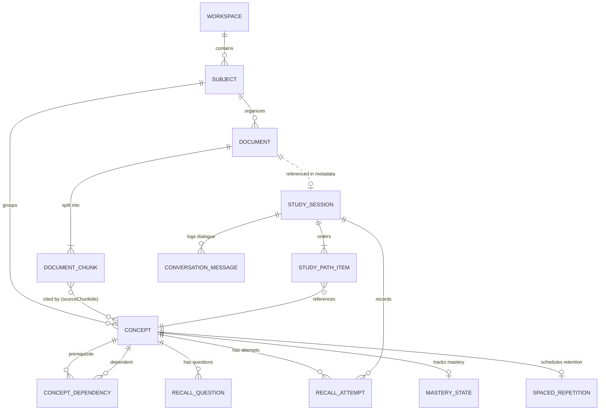

# REFACTOR_AUDIT.md — Technical Audit & Gap Analysis

**Project:** EduMentor Workflow Refactor  
**Phase:** R1 — AUDIT  
**Evidence Standard:** EXECUTED (empirically run & observed), READ (static analysis & inspection), or UNKNOWN.

---

## Section 3: Architecture Map

### 3.1 Routing & Layout Hierarchy
EduMentor is built on Next.js 16 App Router using strict TypeScript, Tailwind CSS v4, and Radix UI primitives.

```
src/app/
├── layout.tsx                    # Root HTML, font setup, global CSS, SplashScreen
├── page.tsx                      # Public marketing landing page (no auth required)
├── privacy/page.tsx              # Local storage privacy and zero-sync transparency
├── settings/page.tsx             # Direct link to workspace settings
├── api/
│   ├── health/route.ts           # Probe endpoint reporting AI status & allowed models
│   └── ai/
│       ├── extract-concepts/     # Batched concept extraction & prerequisite mapping
│       ├── generate-question/    # Concept-targeted active recall question generation
│       ├── evaluate-answer/      # Hybrid rubric evaluation with prompt-injection defense
│       └── explain-concept/      # Socratic explanation & conversational simplification
└── app/
    ├── page.tsx                  # Workspace Home / Study Dashboard
    ├── materials/page.tsx        # Step 1 / Materials ingestion, preview & chunk viewer
    ├── path/page.tsx             # Step 2 / Concept dependency graph & study path DAG
    ├── tutor/page.tsx            # Step 4 / Socratic tutor & active recall practice
    ├── review/page.tsx           # Step 3/4 / SM-2 spaced repetition queue
    ├── progress/page.tsx         # Mastery metrics & attempt history
    └── settings/page.tsx         # Backup export/import, persistence & model config
```

### 3.2 Layout & Component Architecture
- **Workspace Shell:** `src/components/workspace/layout.tsx` wraps all `/app/*` routes. It orchestrates:
  - Accessible skip-links (`#main-content`)
  - Top navigation bar (`header.tsx`) with save indicator (`idle | saving | saved | error`)
  - Storage Quota / Save failure alert banner
  - Due spaced reviews banner (`useReviewStore`)
  - Collapsible desktop sidebar (`sidebar.tsx`) and mobile drawer navigation
  - Floating AI assistant panel (`assistant.tsx`)
  - Global error boundaries (`src/components/ui/error-boundary.tsx`) and toast viewports.

### 3.3 State Management & Client Stores
Client state is managed by 5 focused Zustand stores in `src/lib/state/`:
1. **`workspace-store.ts`:** Active view (`workspace | materials | concepts | recall | review | progress | settings`), online status, mobile drawer state, toast queue, right panel collapsed state.
2. **`session-store.ts`:** Active document ID, active session ID, selected concept ID, current concept pointer.
3. **`review-store.ts`:** Spaced review due counts (`totalDueCount`, `weakCount`), banner dismissal status, periodic due refreshing.
4. **`save-status-store.ts`:** Persistence mode (`idb | memory`), save state (`idle | saving | saved | error`), quota alert messages, local data notice state.
5. **`avatar-store.ts`:** Pedagogical avatar emotion and speaking status (`Idle | Greeting | Explaining | Thinking | Listening | Celebration | Happy | Supportive | Reminder`).

### 3.4 Storage & IndexedDB Subsystem
- **Core Wrapper (`src/lib/db/indexeddb.ts`):** Implements `openDatabase` with connection pooling, blocking/blocked upgrade handlers, and `runTransaction` for atomic multi-store commits.
- **Schema & Validation (`src/lib/db/schema.ts`):** `SCHEMA_VERSION = 1` defining 14 typed stores with Zod schemas.
- **Repository Pattern (`src/lib/db/repositories/idb-repositories.ts`):** Domain repositories (`workspace`, `documents`, `chunks`, `concepts`, `dependencies`, `sessions`, `pathItems`, `questions`, `attempts`, `mastery`, `spacedRepetition`, `messages`, `events`) exposing typed queries.
- **Fallback Adapter (`src/lib/db/repositories/memory-repositories.ts`):** In-memory storage adapter mirroring the IndexedDB interface for private/restricted browsing.
- **Backup Subsystem (`src/lib/db/backup.ts`):** Single-file JSON envelope (`format: "edumentor-backup"`) with 50MB limits, prototype-pollution defenses, and pre-restore rollback safety.

### 3.5 Serverless AI Gateway (`src/lib/ai/`)
- **Server Boundary:** `src/lib/ai/gemini.ts` starts with `import 'server-only'`. Zero AI SDK code reaches the browser.
- **AI Gateway Wrapper (`src/lib/ai/guard.ts`):** `withAiGuard` enforces:
  - 512 KiB max payload limits
  - SHA-256 hashed client IP sliding-window rate limits (25 req/min)
  - Concurrency limiter (max 8 concurrent in-flight requests)
  - Zero-data-leakage privacy logger (`safeLog`: never logs notes, answers, prompts, or API keys)
  - 45s execution timeouts with 2-attempt exponential backoff on 503/429
  - 1-shot structured repair loop on malformed JSON outputs.

---

### 3.6 End-to-End Trace of Study Material

```
[Uploaded File (.txt, .md, .pdf)]
        │
        ▼
1. Selection & Drop: <MaterialsView /> (src/components/materials/materials-view.tsx:232)
        │
        ▼
2. Validation: validateUploadFile (src/features/ingestion/validate.ts:38)
   Checks: extension, MIME, size (<25MB), magic numbers (%PDF- signature).
        │
        ▼
3. Extraction: extractDocumentText (src/features/ingestion/extract-text.ts:52)
   - PDF: lazy-loaded `pdfjs-dist` worker extracting text and page breaks.
   - TXT/MD: UTF-8 `TextDecoder` with BOM stripping.
        │
        ▼
4. Hashing & Deduplication Check: computeSha256 & findDuplicateDocument (src/features/ingestion/ingest.ts:107)
   Rejects identical documents by SHA-256 content hash.
        │
        ▼
5. Normalization: normalizeDocument (src/features/ingestion/normalize.ts:32)
   De-hyphenates line wraps, standardizes Unicode, preserves precise offset maps.
        │
        ▼
6. Chunking: chunkDocument (src/features/ingestion/chunk.ts:58)
   Slices text into semantic chunks (~800–1200 chars) with heading hierarchy paths.
        │
        ▼
7. Atomic Persistence: runTransaction(['documents', 'documentChunks']) (src/features/ingestion/ingest.ts:227)
   Commits DocumentRecord + all DocumentChunkRecords in ONE IndexedDB transaction.
        │
        ▼
8. Gemini Concept Analysis: extractConceptsForDocument (src/features/concepts/pipeline.ts:82)
   - Batches chunks into <=10 chunk / <=10,000 char windows.
   - Calls `/api/ai/extract-concepts` sequentially with progress callbacks.
   - Cleans hallucinated chunk IDs against genuine chunk IDs.
        │
        ▼
9. Deduplication & Prerequisite DAG: deduplicateConcepts & buildDependencyGraph (src/features/dependency-graph:62)
   - Jaccard similarity & title normalization.
   - Tarjan SCC cycle detection & lowest-confidence cycle breaking.
   - Kahn topological sort assigning depth tiers (T0: foundational, T1: core, T2: advanced).
        │
        ▼
10. Atomic Graph Persistence: runTransaction(['concepts', 'conceptDependencies', 'documents']) (src/features/concepts/pipeline.ts:284)
    Commits ordered concepts, resolved dependencies, and analysisStatus = 'completed'.
        │
        ▼
11. Study Path Initialization: initializeStudyPathForDocument (src/features/study-path/service.ts:47)
    Creates StudySessionRecord and StudyPathItemRecords in topological order.
```

---

## Section 4: Feature Inventory

Every feature was audited for implementing files, data read/written, storage mechanism, and verified with an explicit evidence level:

| Feature | Implementing Files | Data Read / Written | Storage Mode | Evidence Level | Verification Notes |
| :--- | :--- | :--- | :--- | :--- | :--- |
| **Material Ingestion & Validation** | `src/features/ingestion/validate.ts`<br>`src/features/ingestion/extract-text.ts`<br>`src/features/ingestion/ingest.ts` | **Read:** Raw File<br>**Write:** `documents`, `documentChunks` | IndexedDB (atomic transaction) | **EXECUTED** | Verified in `materials.spec.ts` (TXT, MD, PDF upload, scanned PDF detection, signature mismatch). |
| **Text Chunking & Provenance** | `src/features/ingestion/chunk.ts`<br>`src/features/ingestion/normalize.ts`<br>`src/features/ingestion/provenance.ts` | **Read:** `documents`<br>**Write:** `documentChunks` | IndexedDB | **EXECUTED** | Verified in `ingestion-normalize-chunk.test.ts` (13 tests passing, exact slice provenance guaranteed). |
| **Concept Extraction & Deduplication** | `src/features/concepts/pipeline.ts`<br>`src/features/concepts/deduplicate.ts`<br>`src/app/api/ai/extract-concepts/` | **Read:** `documentChunks`<br>**Write:** `concepts`, `conceptDependencies`, `documents` | IndexedDB | **EXECUTED** | Verified in `concept-pipeline.test.ts` (16 tests) and E2E `materials.spec.ts:124`. |
| **Prerequisite DAG & Dependency Graph** | `src/features/dependency-graph/graph.ts`<br>`src/features/dependency-graph/scc.ts`<br>`src/features/dependency-graph/topological.ts` | **Read:** `concepts`, `conceptDependencies`<br>**Write:** Topological tiers, active edges | In-memory algorithm, saved to IndexedDB | **EXECUTED** | Verified in `dependency-graph.test.ts` (20 tests, Tarjan SCC + Kahn sort) and `path.spec.ts:195`. |
| **Study Path & Eligibility Engine** | `src/features/study-path/service.ts`<br>`src/features/mastery/eligibility.ts` | **Read:** `concepts`, `dependencies`, `masteryStates`<br>**Write:** `studySessions`, `studyPathItems` | IndexedDB | **EXECUTED** | Verified in `study-path-service.test.ts` and `path.spec.ts:159`. |
| **Socratic Tutoring & Question Generator** | `src/features/recall/question-service.ts`<br>`src/app/api/ai/generate-question/`<br>`src/app/api/ai/explain-concept/` | **Read:** `concepts`, `documentChunks`<br>**Write:** `recallQuestions`, `conversationMessages` | IndexedDB | **EXECUTED** | Verified in `generate-question-route.test.ts` and E2E `learning-journey.spec.ts:107`. |
| **Hybrid Answer Evaluation** | `src/features/evaluation/hybrid-evaluator.ts`<br>`src/app/api/ai/evaluate-answer/`<br>`src/lib/scoring/rubric.ts` | **Read:** User answer, question, concept<br>**Write:** `recallAttempts`, `learningEvents` | IndexedDB | **EXECUTED** | Verified in `hybrid-evaluator.test.ts` (12 tests) and `evaluate-answer-route.test.ts` (6 tests). |
| **SM-2 Spaced Repetition Engine** | `src/features/spaced-repetition/sm2.ts`<br>`src/features/spaced-repetition/queue.ts`<br>`src/features/spaced-repetition/revision.ts` | **Read:** `spacedRepetitionStates`, `recallAttempts`<br>**Write:** `spacedRepetitionStates` | IndexedDB | **EXECUTED** | Verified in `sm2.test.ts` (16 tests) and `review-queue.test.ts` (10 tests). |
| **Mastery Tracking (5 Levels)** | `src/features/mastery/service.ts`<br>`src/lib/config/mastery.ts` | **Read:** `recallAttempts`<br>**Write:** `masteryStates` | IndexedDB | **EXECUTED** | Verified in `mastery-service.test.ts` and `calibration.test.ts` (21 tests). |
| **13-State Conversation Machine** | `src/features/conversation/machine.ts`<br>`src/features/conversation/use-learning-session.ts` | **Read:** `studySessions`, `recallAttempts`<br>**Write:** `studySessions`, `conversationMessages` | IndexedDB + React hook | **EXECUTED** | Verified in `conversation-machine.test.ts` (23 tests) and `learning-journey.spec.ts`. |
| **Pedagogical Vector Avatar** | `src/components/avatar/teacher-avatar.tsx`<br>`src/components/avatar/mapping.ts` | **Read:** Conversation state & evaluation grade<br>**Write:** SVG rendering state | React + CSS Animation | **EXECUTED** | Verified in `avatar.test.ts` (11 tests). |
| **Session Persistence & Recovery** | `src/features/conversation/learning-session-service.ts`<br>`src/features/conversation/recovery.ts` | **Read:** Incomplete `studySessions`<br>**Write:** Recovered `studySessions` | IndexedDB | **EXECUTED** | Verified in `learning-session-persistence.test.ts` (8 tests) and E2E `learning-journey.spec.ts:185`. |
| **JSON Backup, Security & Rollback** | `src/lib/db/backup.ts` | **Read:** All 14 IndexedDB stores<br>**Write:** JSON file / IndexedDB restore | IndexedDB + File download | **EXECUTED** | Verified in `backup.test.ts` (16 tests) and `backup.spec.ts`. |
| **Settings, Model & Persistence Config** | `src/components/settings/settings-view.tsx`<br>`src/lib/db/storage-status.ts` | **Read:** `workspace`, `/api/health`<br>**Write:** `workspace.preferences` | IndexedDB | **EXECUTED** | Verified in `persistence.spec.ts` (difficulty and reduced motion persistence across reload). |

---

## Section 5: Data Model & The 5 Explicit Inquiries

### 5.1 IndexedDB Store Schema (Version 1)
Current schema version is `1`. There are 14 stores created in `src/lib/db/migrations.ts`:

| Store Name | Key Path | Indexes Defined | Record Type |
| :--- | :--- | :--- | :--- |
| `workspace` | `id` | `by-updated` (`updatedAt`) | `WorkspaceRecord` |
| `subjects` | `id` | `by-title` (`title`) | `SubjectRecord` |
| `documents` | `id` | `by-created` (`createdAt`), `by-subject` (`subjectId`) | `DocumentRecord` |
| `documentChunks` | `id` | `by-document` (`documentId`), `by-doc-index` (`['documentId', 'chunkIndex']`) | `DocumentChunkRecord` |
| `concepts` | `id` | `by-subject` (`subjectId`), `by-status` (`status`) | `ConceptRecord` |
| `conceptDependencies` | `id` | `by-prerequisite` (`prerequisiteId`), `by-dependent` (`dependentConceptId`), `by-prereq-dep` (`['prerequisiteId', 'dependentConceptId']`) | `ConceptDependencyRecord` |
| `studySessions` | `id` | `by-updated` (`updatedAt`), `by-status` (`machineState`) | `StudySessionRecord` |
| `studyPathItems` | `id` | `by-session` (`sessionId`), `by-session-order` (`['sessionId', 'orderIndex']`) | `StudyPathItemRecord` |
| `recallQuestions` | `id` | `by-concept` (`conceptId`) | `RecallQuestionRecord` |
| `recallAttempts` | `id` | `by-concept` (`conceptId`), `by-session` (`sessionId`), `by-created` (`createdAt`) | `RecallAttemptRecord` |
| `masteryStates` | `id` | `by-concept` (`conceptId`), `by-updated` (`updatedAt`) | `MasteryStateRecord` |
| `spacedRepetitionStates`| `id` | `by-next-due` (`nextDueAt`), `by-concept` (`conceptId`) | `SpacedRepetitionStateRecord` |
| `conversationMessages` | `id` | `by-session` (`sessionId`), `by-created` (`createdAt`) | `ConversationMessageRecord` |
| `learningEvents` | `id` | `by-event-type` (`eventType`), `by-created` (`createdAt`) | `LearningEventRecord` |

### 5.2 Entity Relationship Diagram (Current Schema)



---

### 5.3 The Five Explicit Architectural Inquiries

#### Q1: Does the current model have a "learning unit" concept?
**Answer: NO.**
In Schema Version 1, there is no `learningUnit` store or entity. The primary unit of content is `DocumentRecord` (with `DocumentChunkRecord`). Study sessions reference documents only loosely via `document.metadata.sessionId` or `session.metadata.documentId`. There is no first-class container representing a curated learning unit (e.g., grouping a set of study materials, custom concept selection, chosen learning mode, and persistent session state).

#### Q2: Does every record link back to a stable materialId?
**Answer: NO.**
- `DocumentChunkRecord` has `documentId: string`.
- `ConceptRecord` has `sourceChunkIds: string[]` and `subjectId?: string`, but **no `documentId` or `materialId` field**. It links to documents only indirectly by inspecting chunk IDs.
- `ConceptDependencyRecord`, `RecallQuestionRecord`, `RecallAttemptRecord`, `MasteryStateRecord`, and `SpacedRepetitionStateRecord` link to `conceptId`, but have **zero direct reference** to `documentId` or `materialId`.
- `StudyPathItemRecord` links to `sessionId` and `conceptId`.
- If a concept is evaluated or revised, its attempt and retention records do not know which original document created it without performing an inverted lookup through `sourceChunkIds` -> `documentChunks` -> `documents`.

#### Q3: How are duplicate uploads currently handled (by filename, hash, or not at all)?
**Answer: Handled by SHA-256 content hash, NOT by filename.**
In `src/features/ingestion/ingest.ts` (lines 107–126), when a file is selected:
1. `fileHash = await computeSha256(uint8)` calculates the SHA-256 digest of the entire file buffer.
2. `findDuplicateDocument(fileHash)` searches all documents in IndexedDB.
3. If a match is found and `allowDuplicate` is `false`, ingestion stops and returns `alreadyImported: true`, `code: 'DUPLICATE_FILE'`.
4. Uploading the same file under a different filename is correctly detected and rejected; uploading a modified file with the same filename is accepted.

#### Q4: What happens to attempts and SM-2 records if a document is deleted?
**Answer: They become ORPHANED in IndexedDB.**
In `src/features/ingestion/ingest.ts` (lines 274–296), `deleteDocumentAndChunks(documentId)` runs an atomic transaction that deletes the document record from `documents` and deletes all matching chunks from `documentChunks`.
It does **NOT** cascade delete `concepts`, `conceptDependencies`, `recallQuestions`, `recallAttempts`, `masteryStates`, `spacedRepetitionStates`, `studySessions`, or `studyPathItems`.
Consequently:
- The concepts remain in the `concepts` store, but their `sourceChunkIds` reference non-existent chunks.
- Past `recallAttempts`, `masteryStates`, and `spacedRepetitionStates` remain stored indefinitely and continue to appear in `/app/review` and `/app/progress` without a parent document.

#### Q5: What happens to attempts and SM-2 records if a document is re-uploaded?
**Answer: Attempts and SM-2 records are NOT reconnected; progress is severed.**
- If a document is re-uploaded while the old document still exists, it is rejected as a duplicate.
- If the old document was deleted first (leaving orphaned concepts and attempts) and the identical file is re-uploaded:
  1. `ingestDocument` generates a new UUID for the document (`documentId`) and new chunk IDs.
  2. `extractConceptsForDocument` generates new UUIDs for the extracted concepts (`conceptId`).
  3. The newly generated concepts have no relationship to the old orphaned concept IDs.
  4. The user's past `recallAttempts`, `masteryStates`, and `spacedRepetitionStates` are not linked to the new concepts. The user must start over from mastery Level 0.

---

## Section 6: Seeded-Data Reproduction

To support R2 migration testing and development against realistic legacy data, a complete schema v1 seed script was constructed in `scripts/seed-data.ts` and verified with `tests/unit/seed-data.test.ts`.

### 6.1 Seed Data Composition
- **2 Realistic Documents:**
  1. `Computer_Systems_Architecture.pdf` (84 KB, 3 chunks covering pipelining, memory hierarchy, cache coherence).
  2. `Foundations_of_Machine_Learning.txt` (32 KB, 3 chunks covering supervised learning, loss functions, gradient descent).
- **6 Structured Concepts across 3 Topological Tiers:**
  - Tier 0: *Instruction Pipelining* (status: `mastered`), *Supervised Learning* (status: `available`).
  - Tier 1: *Memory Hierarchy* (status: `review_due`), *Empirical Loss Functions* (status: `locked`).
  - Tier 2: *Cache Coherence & MESI* (status: `in_progress`), *Gradient Descent Optimization* (status: `locked`).
- **4 Prerequisite Dependencies:** Forming two valid DAGs.
- **Active Study Session:** On *Cache Coherence & MESI* with saved draft answer and confidence rating 3.
- **Recall Practice:** 3 questions and 2 evaluated attempts (`hybrid` mode, quality grades 5 and 3).
- **Mastery States:** Level 4 (95%), Level 2 (65%), Level 1 (30%).
- **SM-2 Spaced Repetition States:** 1 item due in 3 days, 1 item overdue by 24 hours.
- **Socratic Dialogue History:** 3 assistant/user conversation messages.

### 6.2 Seed Verification (`EXECUTED`)
Executed via `npx vitest run tests/unit/seed-data.test.ts`:
- **Result:** 2 tests passed (18ms).
- **Confirmed:**
  1. `BackupEnvelopeSchema` validates the seed data with zero errors at `SCHEMA_VERSION = 1`.
  2. All 14 stores are seeded transactionally into IndexedDB.
  3. Compound queries (`by-document`, `by-session`, `by-next-due`) retrieve seeded records accurately.

---

## Section 7: Risk Register

| Risk ID | Risk Description | Likelihood | Impact | Proposed Mitigation |
| :--- | :--- | :--- | :--- | :--- |
| **R-01** | **Schema Migration Failure on Existing User Databases**<br>Introducing new stores or fields causes `openDB` upgrade errors. | Low | Critical | Register strictly additive migration v2 in `migrations.ts`. Never delete old tables. Wrap migrations in `try/catch` with automated rollback and transaction abort. Pre-tested against `scripts/seed-data.ts`. |
| **R-02** | **Orphaned Entities on Material Deletion or Re-organization**<br>Deleting a material leaves unreferenced concepts, attempts, or SM-2 records. | High | Medium | In R2, implement cascading cleanup or explicit disassociation in `deleteDocumentAndChunks` and learning unit disassociation transactions. |
| **R-03** | **Loss of In-Flight Workflow / Socratic Session State**<br>User switches between workflow steps (e.g. from Add to Mode) and loses draft answers. | Med | High | Bind all workflow steps to a persistent `LearningUnit` / `StudySession` in IndexedDB via `useSessionStore` and `safeWrite`. Never store workflow state only in React component state. |
| **R-04** | **IndexedDB Quota Exceeded on Large PDF Uploads**<br>Extracting large PDFs in Step 1 exhausts mobile browser storage quota. | Med | High | Maintain existing `safeWrite` quota interception. Check file size limits (<25MB) before processing. Provide export & cleanup prompt if `StorageQuotaExceededError` triggers. |
| **R-05** | **Breaking Existing Deep Links & Tests**<br>Refactoring routes causes existing E2E tests (`/app/materials`, `/app/path`, `/app/tutor`) to fail. | Med | High | In R3, retain existing routes as internal views or redirects within the 4-step workflow shell. Ensure legacy paths remain accessible or cleanly redirect to corresponding workflow steps. |
| **R-06** | **AI Gateway Rate-Limiting During Step 2 Extraction**<br>Sequential batching of chunks hits 25 req/min rate limit on long documents. | Med | Medium | Retain existing chunk batching (10 chunks/window), bounded concurrency (max 8), and exponential backoff retry. Surface progress UI and pause/resume controls. |

---

## Section 8: Gap Analysis (Tab Interface vs 4-Step Guided Workflow)

### 8.1 Comparison Matrix

| Workflow Dimension | Current Tab-Based Architecture | Target 4-Step Guided Workflow | Required Refactor Changes |
| :--- | :--- | :--- | :--- |
| **Primary Navigation** | Flat sidebar tabs: *Home*, *Materials*, *Concept Map*, *Recall Practice*, *Spaced Review*, *Progress*, *Settings*. | Linear guided stepper: **(1) Add Material** &rarr; **(2) Organise Material** &rarr; **(3) Choose Mode** &rarr; **(4) Learning Session**. | Create guided workflow shell component (`WorkflowStepper`). Guide users step-by-step while retaining access to settings and history. |
| **Container Concept** | None. Documents and Concepts float independently in global IndexedDB tables. | First-class **Learning Unit** (`learningUnits` store). | Add `learningUnits` table linking source documents, selected concepts, and active session configuration. |
| **Material to Mode Transition** | User must manually upload in *Materials*, click *Concept Map* to view DAG, then navigate to *Recall Practice*. | Seamless progression: Step 1 (upload) auto-advances to Step 2 (concepts), then to Step 3 (mode), then Step 4 (session). | Connect pipeline completion callbacks directly to workflow stepper navigation. |
| **Mode Selection** | Fragmented across separate routes: `/app/tutor` (study/recall) and `/app/review` (spaced review). | Unified in **Step 3 (Choose Learning Mode)**: Socratic Study, Active Recall, or Spaced Revision. | Build mode selection cards in Step 3 configuring session parameters before launching Step 4. |
| **State Persistence** | Transient states (e.g., active preview tab, selected document in materials view) live only in React state. | Workflow stage and active unit persist in IndexedDB and sync to URL query params (`?step=X&unitId=Y`). | Persist workflow progress to `learningUnits` or `workspace` state store so users can resume mid-flow. |

### 8.2 Reusable Components & Subsystems
- **Ingestion & Validation Engine (`src/features/ingestion/*`):** 100% reusable as the engine for Step 1.
- **Concept Extraction & Dependency DAG (`src/features/dependency-graph/*`, `src/features/concepts/*`):** 100% reusable as the engine for Step 2.
- **SVG Dependency Graph Canvas (`src/components/study-path/PathGraphView.tsx`):** 100% reusable in Step 2 for visual concept organization.
- **13-State Conversation Machine (`src/features/conversation/*`):** 100% reusable as the core driver for Step 4.
- **Hybrid Evaluator & Rubric Scoring (`src/features/evaluation/*`, `src/lib/scoring/*`):** 100% reusable for evaluation in Step 4.
- **SM-2 Spaced Repetition Engine (`src/features/spaced-repetition/*`):** 100% reusable when Spaced Revision mode is chosen.
- **Teacher Avatar (`src/components/avatar/*`):** 100% reusable across Step 4 learning dialogues.
