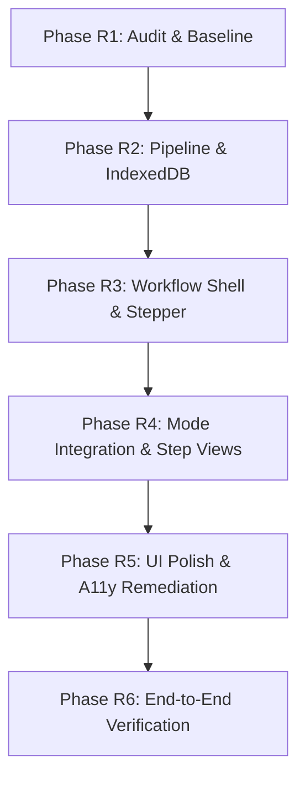

# REFACTOR_PLAN.md — Guided 4-Step Workflow Refactor Plan

**Project:** EduMentor  
**Target Architecture:** Guided 4-Step Workflow:  
(1) Add Material &rarr; (2) Organise Material &rarr; (3) Choose Learning Mode &rarr; (4) Learning Session  
**Phases:** R1 (Audit) &rarr; R2 (Pipeline/IndexedDB) &rarr; R3 (Workflow Shell) &rarr; R4 (Mode Integration) &rarr; R5 (UI Polish) &rarr; R6 (E2E Verification)

---

## 1. Executive Summary & Objective

The objective of this refactor is to evolve EduMentor from its current tab-based interface (where users manually switch between *Materials*, *Concept Map*, *Recall Practice*, and *Spaced Review*) into a seamless, cohesive, guided four-step learning workflow:
1. **Step 1: Add Material** — Document upload (PDF, TXT, MD), format validation, text extraction, deduplication, and chunk preview.
2. **Step 2: Organise Material** — AI concept extraction, prerequisite DAG visualization, concept selection/filtering, and topological tier arrangement.
3. **Step 3: Choose Learning Mode** — Selection between *Socratic Tutoring* (study mode), *Active Recall Practice* (testing mode), or *Spaced Revision* (retention mode).
4. **Step 4: Learning Session** — Focused interactive learning experience driven by the 13-state conversation engine, SVG avatar, hybrid evaluation (ONNX embeddings + Gemini judge rubric), and SM-2 retention scheduling.

### Hard Constraints
- **Preserve All Core Logic:** Zero rewriting of ingestion, chunking, topological graph algorithms, hybrid evaluation, SM-2, conversation machines, avatar emotions, or JSON backups.
- **IndexedDB Only:** No external database, auth, or cloud persistence.
- **Additive Schema Migrations:** All schema updates must be strictly versioned (`SCHEMA_VERSION = 2`) with backwards-compatible upgrade paths.
- **Evidence-Based Reporting:** Every feature status must be reported as `EXECUTED`, `READ`, or `UNKNOWN`.

---

## 2. Baseline Status & Pre-Existing Issues

- **Lint:** `npm run lint` &rarr; 0 errors, 0 warnings (**PASS**).
- **Typecheck:** `npm run typecheck` &rarr; 0 errors (**PASS**).
- **Unit Tests:** `npm run test` &rarr; 47 files passed (47/47), 422 tests passed (422/422) (**PASS**).
- **Security & Stateless Checks:** `npm run check:bundle` & `npm run check:persistence` (**PASS**).
- **Contrast Check:** `npm run check-contrast` &rarr; WCAG 2.2 AA compliant (**PASS**).
- **Production Build:** `npm run build` &rarr; All 18 routes compiled successfully (**PASS**).
- **E2E Tests:** `npm run test:e2e` &rarr; 16 passed, 5 failed due to **pre-existing splash screen issues** in `src/components/splash/splash-screen.tsx`:
  - Missing `aria-label` or `aria-labelledby` on `<div role="progressbar">` (violating `aria-progressbar-name`).
  - Strict mode locator collision on `getByText('EduMentor')` while the ~4.5s splash animation is mounted.
  *(These 5 issues will be fixed cleanly in Phase R5 without any disruption to application code in R1).*

---

## 3. Data Model Refactor Strategy (Phase R2)

### 3.1 Schema Version 2 Additive Evolution
To solve the architectural gaps identified in the audit (lack of a learning unit container, orphaned concepts, and disconnected attempts), Schema Version 2 introduces an additive `learningUnits` store:

```typescript
export interface LearningUnitRecord {
  id: string;                         // UUID
  title: string;                      // Display title
  description?: string;               // Optional overview
  documentIds: string[];              // Associated source document IDs
  conceptIds: string[];               // Curated concept IDs in this unit
  activeMode: 'study' | 'recall' | 'revision'; // Selected learning mode
  sessionId?: string;                 // Linked active StudySession ID
  currentStep: 1 | 2 | 3 | 4;         // Current step in guided workflow
  completedAt?: string;               // Timestamp when session completed
  createdAt: string;                  // ISO timestamp
  updatedAt: string;                  // ISO timestamp
}
```

### 3.2 Backwards-Compatible Migration Plan
1. `SCHEMA_VERSION` is updated from `1` to `2`.
2. `migrationV2` in `src/lib/db/migrations.ts` creates:
   - `learningUnits` object store with indexes: `by-updated` (`updatedAt`), `by-mode` (`activeMode`).
   - Optional indexes in existing stores if needed: `by-unit` on `studySessions`.
3. Pre-existing v1 databases upgrade automatically upon open. All 14 existing stores remain untouched.
4. Legacy backup files (`schemaVersion: 1`) continue to import cleanly with automatic default learning unit synthesis.

---

## 4. Phased Implementation Roadmap (R2–R6)



### Phase R2: Pipeline & IndexedDB Foundation
- **Objectives:**
  - Implement Schema Version 2 with `learningUnits` store and backwards-compatible migration in `src/lib/db/migrations.ts`.
  - Add `learningUnits` repository to `src/lib/db/repositories/idb-repositories.ts` and `memory-repositories.ts`.
  - Build `src/features/learning-units/service.ts` for transactional unit lifecycle (create, update step, bind session, clean up).
  - Update `src/lib/db/backup.ts` to include `learningUnits` in version 2 backup envelopes while maintaining backwards compatibility with v1 backups.
  - Verify migration using `scripts/seed-data.ts` to ensure 100% data preservation.
- **Files to Modify:**
  - `src/lib/db/schema.ts`
  - `src/lib/db/indexeddb.ts`
  - `src/lib/db/migrations.ts`
  - `src/lib/db/repositories/types.ts`
  - `src/lib/db/repositories/idb-repositories.ts`
  - `src/lib/db/repositories/memory-repositories.ts`
  - `src/types/domain.ts`
  - `src/lib/db/backup.ts`
- **Files to Add:**
  - `src/features/learning-units/types.ts`
  - `src/features/learning-units/service.ts`
  - `tests/unit/learning-units.test.ts`
  - `tests/unit/migration-v2.test.ts`
- **Acceptance Criteria:**
  - `SCHEMA_VERSION` is 2.
  - Unit tests verify migrating a seeded v1 database to v2 preserves all documents, chunks, concepts, attempts, and SM-2 records without loss.
  - Backup/restore round-trip succeeds for both v1 and v2 envelopes.
  - All 424+ unit tests pass.

---

### Phase R3: Workflow Shell & Stepper
- **Objectives:**
  - Create the accessible, responsive 4-step workflow shell (`WorkflowShell`) and step indicator (`WorkflowStepper`).
  - Support linear progression (1 &rarr; 2 &rarr; 3 &rarr; 4) with clear active/completed/locked states and keyboard navigation.
  - Provide direct deep-linking via `/app/workflow?unitId=<id>&step=<1-4>`.
  - Maintain legacy `/app/*` routes for power users and existing bookmarks.
  - Add workflow navigation entry in `WorkspaceSidebar` and mobile drawer.
- **Files to Modify:**
  - `src/components/workspace/sidebar.tsx`
  - `src/components/workspace/header.tsx`
  - `src/lib/state/workspace-store.ts`
- **Files to Add:**
  - `src/app/app/workflow/page.tsx`
  - `src/components/workflow/WorkflowShell.tsx`
  - `src/components/workflow/WorkflowStepper.tsx`
  - `tests/unit/workflow-stepper.test.tsx`
- **Acceptance Criteria:**
  - Stepper renders all 4 steps with WCAG 2.2 AA compliant contrast, `aria-current="step"`, and keyboard navigation.
  - Step transitions update URL query parameters and persist the current step in the active learning unit.
  - Sidebar reflects workflow presence without breaking legacy links.

---

### Phase R4: Mode Integration & Step Views
- **Objectives:**
  - **Step 1 View (`Step1AddMaterial.tsx`):** Embeds the proven ingestion pipeline (`src/features/ingestion/*`), file drag-and-drop, PDF.js extraction, and chunk preview. On upload completion, auto-advances to Step 2.
  - **Step 2 View (`Step2OrganiseMaterial.tsx`):** Triggers concept extraction (`src/features/concepts/*`), presents interactive prerequisite DAG (`PathGraphView.tsx`) and list view, allows concept inclusion/exclusion, and advances to Step 3.
  - **Step 3 View (`Step3ChooseMode.tsx`):** Presents 3 interactive cards with pedagogical explanations:
    1. *Socratic Study* (guided dialogue and concept exploration).
    2. *Active Recall* (formative question generation & rubric evaluation).
    3. *Spaced Revision* (retention refresher prioritizing due/weak concepts).
  - **Step 4 View (`Step4LearningSession.tsx`):** Hosts the active session powered by `useLearningSession()`, teacher avatar expressions, hybrid answer evaluation, feedback rubric, and SM-2 retention scheduling.
- **Files to Modify:**
  - `src/app/app/workflow/page.tsx`
  - `src/features/conversation/use-learning-session.ts`
  - `src/features/study-path/service.ts`
- **Files to Add:**
  - `src/components/workflow/steps/Step1AddMaterial.tsx`
  - `src/components/workflow/steps/Step2OrganiseMaterial.tsx`
  - `src/components/workflow/steps/Step3ChooseMode.tsx`
  - `src/components/workflow/steps/Step4LearningSession.tsx`
  - `tests/unit/workflow-mode-integration.test.tsx`
- **Acceptance Criteria:**
  - Uploading a document in Step 1 initiates concept extraction and enables progression to Step 2.
  - Step 2 renders concepts in topological order with tier badges.
  - Selecting any mode in Step 3 initializes a study session with the correct `sourceMode` and launches Step 4.
  - Step 4 allows answering questions, shows hybrid evaluation scores, updates mastery, and calculates next SM-2 review dates.

---

### Phase R5: UI Polish & Accessibility Remediation
- **Objectives:**
  - **Remediate Pre-Existing Splash Screen Issues:**
    - In `src/components/splash/splash-screen.tsx` (line 399), add `aria-label="EduMentor initialization progress"` and `aria-valuetext` to the progressbar `<div>`.
    - Disambiguate the splash screen brand heading to prevent strict mode locator collisions during test runs.
  - Polish workflow transitions with subtle, GPU-accelerated micro-animations adhering to `prefers-reduced-motion`.
  - Verify WCAG 2.2 AA contrast across all new stepper states (default, hover, active, completed, disabled).
  - Ensure focus traps, keyboard shortcuts (`Alt + 1..4`), and screen-reader live regions report step transitions clearly.
- **Files to Modify:**
  - `src/components/splash/splash-screen.tsx`
  - `src/components/workflow/WorkflowStepper.tsx`
  - `src/components/workflow/WorkflowShell.tsx`
  - `src/app/globals.css`
- **Acceptance Criteria:**
  - `accessibility.spec.ts` passes with 0 axe-core violations on desktop landing, desktop workspace, and mobile workspace.
  - `path.spec.ts:214` passes with 0 axe-core violations on `/app/path`.
  - `workspace-shell.spec.ts:4` passes with zero strict mode locator collisions.
  - All 21 baseline Playwright E2E tests pass.

---

### Phase R6: End-to-End Verification & Production Readiness
- **Objectives:**
  - Construct comprehensive E2E test suite `tests/e2e/guided-workflow.spec.ts` verifying:
    1. Complete 4-step workflow journey from file upload to concept organisation, mode selection, and answer evaluation.
    2. Step-by-step back and forward navigation with full state preservation.
    3. Workflow resilience against browser reload at each of the 4 steps.
    4. Backup export and restore containing learning units.
  - Execute full test battery: lint, typecheck, unit tests, bundle check, persistence check, contrast check, production build, and all Playwright specs.
  - Prepare final Phase R6 report and deployment verification checklist.
- **Files to Add:**
  - `tests/e2e/guided-workflow.spec.ts`
- **Acceptance Criteria:**
  - 100% passing tests across all unit and E2E suites.
  - Zero lint warnings and zero TypeScript errors.
  - Production build (`npm run build`) completes with zero errors.

---

## 5. Unknowns & Resolution Plan

| Unknown | Impact | Resolution Phase |
| :--- | :--- | :--- |
| **U-01: Multi-document Learning Units**<br>Should a learning unit in Step 1 accept multiple simultaneous file uploads or a single primary document per unit? | Medium | **Resolved in R2:** Schema v2 `LearningUnitRecord` defines `documentIds: string[]` to support multi-file units additively, while Step 1 UI initially allows uploading 1 or more documents. |
| **U-02: Legacy Session Migration**<br>How should existing standalone sessions (from v1) be presented in the new workflow? | Low | **Resolved in R2/R3:** Any existing active session without a `learningUnitId` is automatically accessible via legacy `/app/tutor` and can be claimed by a "Resume previous session" action on the workflow home screen. |
| **U-03: Offline Mode Switch**<br>If a user chooses Socratic Study in Step 3 while offline or when Gemini quota is exhausted, how does the session proceed? | Medium | **Resolved in R4:** The offline teaching service (`src/features/concepts/teaching-service.ts`) automatically kicks in, presenting stored canonical explanations with an honest "AI Tutor unavailable; showing saved notes" banner. |
