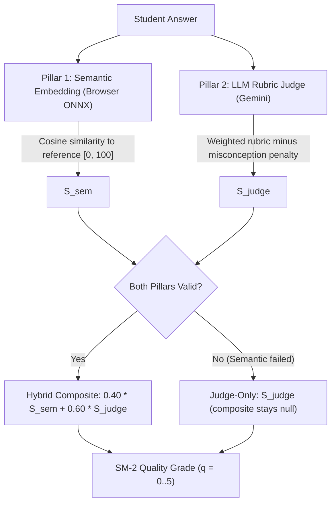

# SCORING.md — EduMentor Evaluation & Scoring Methodology

## 1. Transparency & Non-Validation Disclosure

> [!WARNING]
> **No Scientific Validation or Academic Equivalence Claimed**
> The scores (0–100), composite metrics, and SM-2 quality grades generated by EduMentor are heuristic automated assessments designed solely to guide personal self-study and revision schedules.
>
> They are **not** standardized educational measurements, have **not** been calibrated or correlated with formal human grading benchmarks, and do **not** imply academic accreditation, course credit, or psychometric validity.

---

## 2. The Hybrid Evaluation Architecture

EduMentor combines two independent evaluation pillars whenever possible:

### Pillar 1: Semantic Embedding Similarity ($S_{\text{sem}}$)
- **Model:** Quantized `all-MiniLM-L6-v2` executed in a client-side Web Worker via `@huggingface/transformers`.
- **Privacy:** Answers are processed completely on the student's device. No student answers are ever transmitted to any embedding API.
- **Reference Text:** Formed from the concept's canonical explanation and expected key points.
- **Cosine-to-Score Calibration:** Linear mapping from cosine similarity range $[0.20, 0.85] \to [0, 100]$:
  $$S_{\text{sem}} = \text{clamp}\left( \frac{\cos(\mathbf{u}, \mathbf{v}) - 0.20}{0.85 - 0.20} \times 100, 0, 100 \right)$$
  *(This heuristic acknowledges that domain answers rarely exceed 0.85 cosine similarity or drop below 0.20 for English text).*

### Pillar 2: LLM Rubric Judge ($S_{\text{judge}}$)
- Evaluates student recall against 5 weighted pedagogical criteria:
  - **Scientific Correctness (35%)**: Factual accuracy and conceptual truth.
  - **Concept Completeness (25%)**: Coverage of required key points.
  - **Logical Reasoning (20%)**: Coherent causal connections and explanations.
  - **Key Terminology (10%)**: Appropriate domain-specific vocabulary.
  - **Topical Relevance (10%)**: Focus on the specific prompt without tangents.
- **Misconception Penalties:** Specific identified misconceptions deduct points based on severity (`minor`: -5, `moderate`: -10, `critical`: -20), capped at a maximum deduction of 25 points.
  $$S_{\text{judge}} = \text{clamp}\left( \sum w_i R_i - \min(\text{penalties}, 25), 0, 100 \right)$$

---

## 3. Evaluation Modes

Every attempt record stores the actual execution mode:

| Mode | Label | Conditions | Composite Score | Grade Derivation |
|---|---|---|---|---|
| `hybrid` | "Hybrid (Semantic embedding + AI Judge)" | Both semantic worker and Gemini judge succeed | `0.40 * S_sem + 0.60 * S_judge` | Mapped from $S_{\text{comp}}$ |
| `judge_only` | "Judge-only (semantic check unavailable)" | Embedding worker timed out, failed to load, or unavailable | `null` (explicitly uncalculated) | Mapped directly from $S_{\text{judge}}$ with UI disclosure |
| `pending` | "Evaluation pending (saved locally)" | Gemini API unavailable or network offline | `null` | Deferred; no mastery or SM-2 state modified |

EduMentor **never fabricates** a missing pillar or pretends hybrid evaluation ran when only the judge was available.

---

## 4. SM-2 Quality Grade Mapping ($q \in [0, 5]$)

Quality grades strictly determine SuperMemo SM-2 interval scheduling:

| Grade ($q$) | Score Range | Meaning | Repetition Impact |
|---|---|---|---|
| **5** | $85 \le \text{Score} \le 100$ | Perfect / near-perfect recall with strong understanding | Advances interval, increases EF |
| **4** | $70 \le \text{Score} < 85$ | Good response with minor omission or hesitation | Advances interval |
| **3** | $55 \le \text{Score} < 70$ | Passing response with noticeable gaps | Advances interval with reduced EF |
| **2** | $40 \le \text{Score} < 55$ | Failing response; serious conceptual flaws | Resets interval to 1 day; flagged for revision |
| **1** | $25 \le \text{Score} < 40$ | Incorrect response; superficial familiarity | Resets interval to 1 day; flagged for revision |
| **0** | $0 \le \text{Score} < 25$ | Complete blackout or completely irrelevant answer | Resets interval to 1 day; flagged for revision |

---

## 5. Mastery Determination

- **Levels:** `new` (0) $\to$ `learning` (1) $\to$ `familiar` (2) $\to$ `proficient` (3) $\to$ `mastered` (4).
- **Mastery %:** Recency-weighted average of up to 5 historical attempts using weights `[0.45, 0.25, 0.15, 0.10, 0.05]`.
- **Honesty Invariant for "Mastered":** A concept can **never** achieve `mastered` status from a single attempt, regardless of a 100% score. It requires at least **two separate successful sessions** ($q \ge 4$) across different calendar days to prevent transient cramming bias.
